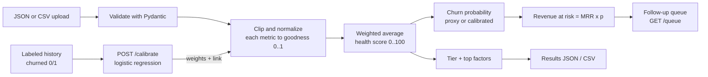

# churn-radar

[](https://github.com/Kauazxz/churn-radar/actions/workflows/ci.yml)

**Customer health scoring and churn-risk prioritization API.** Send your customer metrics as JSON
or CSV and get back a 0–100 health score, a risk tier, the factors that pulled each score down,
and a follow-up queue ordered by how much revenue is at risk. If you have historical outcomes,
`POST /calibrate` fits the metric weights with a logistic regression and reports holdout AUC.

Built with FastAPI, Pydantic v2 and scikit-learn. The scoring core is a plain Python module with
no web dependency, so it can be tested and reused on its own.

## Background

At the InovaApps 2026 university hackathon, my team took on a challenge from Globalsys and built a
churn-risk platform in TypeScript. This repository is my own, smaller re-implementation in Python,
written from scratch to focus on the data and API side: explainable scoring, weight calibration
and a clean HTTP contract.

## How the score works

Each metric $m$ in the config has a direction, normalization bounds $[L_m, U_m]$ and a weight
$w_m \ge 0$. A raw value $x_m$ is clipped to the bounds and turned into a *goodness* in $[0, 1]$,
where 1 is always the healthy end:

$$
s_m = \frac{\min(\max(x_m, L_m), U_m) - L_m}{U_m - L_m},
\qquad
g_m =
\begin{cases}
s_m & \text{higher is better} \\
1 - s_m & \text{higher is worse}
\end{cases}
$$

The health score is the weighted average of goodness over the metrics present for that customer
(weights are renormalized when a value is missing, and the missing metric is reported):

$$
H = 100 \cdot \frac{\sum_m w_m \, g_m}{\sum_m w_m}
$$

- **Tier**: `healthy` if $H \ge 75$, `watch` if $H \ge 55$, `at_risk` if $H \ge 35$, otherwise
  `critical`. Thresholds are configurable.
- **Factors (explainability)**: each metric removes $100 \cdot \tilde w_m (1 - g_m)$ points from
  100, where $\tilde w_m$ is the normalized weight. These "points lost" add up exactly to $100 - H$;
  the top N (default 3) are returned per customer.
- **Churn probability**: before calibration this is only a linear proxy, $p = 1 - H/100$. After
  calibration it is the fitted logistic link $p = \sigma(b_0 - k \cdot H/100)$.
- **Revenue at risk** $= \text{MRR} \times p$. The follow-up queue sorts by revenue at risk
  (descending), then by health (ascending), then by customer id.

Default metrics: `days_since_last_login`, `tickets_last_30d`, `usage_trend`, `nps`,
`payment_delays`, `seats_utilization`. You can replace them with any metrics via `PUT /config`.



## Quickstart

With [uv](https://docs.astral.sh/uv/):

```bash
uv venv && uv pip install -e ".[dev]"
uv run uvicorn churn_radar.api:app --reload
```

With pip:

```bash
python -m venv .venv && source .venv/bin/activate
pip install -e ".[dev]"
uvicorn churn_radar.api:app --reload      # or: churn-radar  (HOST/PORT env vars)
```

With Docker:

```bash
docker build -t churn-radar .
docker run --rm -p 8000:8000 churn-radar
```

Interactive docs are at http://127.0.0.1:8000/docs. Ready-made requests are in
[`examples/requests.http`](examples/requests.http).

Run the checks:

```bash
pytest
ruff check . && ruff format --check .
mypy churn_radar scripts tests
```

## API

| Method | Path | What it does |
| --- | --- | --- |
| `POST` | `/score` | JSON batch of customers → scores, tiers, factors, summary |
| `POST` | `/score/csv` | CSV upload → same; `?format=csv` returns a CSV download |
| `GET` | `/config` | Current config plus normalized weights |
| `PUT` | `/config` | Replace the config (validated: bounds, weights ≥ 0 with a positive sum, unique names, descending thresholds) |
| `POST` | `/calibrate` | JSON customers with `churned` → fitted weights and holdout AUC; `"apply": true` saves them |
| `POST` | `/calibrate/csv` | Same from a CSV with a `churned` column (`?apply=true`, `?seed=`, `?test_size=`) |
| `GET` | `/queue?limit=N` | Top N customers of the last scored batch by revenue at risk |
| `GET` | `/healthz` | Liveness |

Every endpoint except `/healthz` reads the `X-Tenant-Id` header (letters, digits, `_ . -`, up to
64 chars; defaults to `default`). Each tenant has its own config and last scored batch.

CSV columns: `customer_id`, `name`, `mrr`, one column per configured metric, and `churned` (0/1)
for calibration. Empty cells count as missing; unknown columns are ignored.

### curl

```bash
curl -s -X POST localhost:8000/score \
  -H 'Content-Type: application/json' -H 'X-Tenant-Id: acme' \
  -d '{"customers":[{"customer_id":"c1","name":"Acme","mrr":1200,
       "metrics":{"days_since_last_login":21,"usage_trend":-0.3,"nps":4}}]}'

curl -s -X POST 'localhost:8000/score/csv?format=csv' \
  -H 'X-Tenant-Id: acme' -F file=@examples/customers.csv -o scores.csv

curl -s 'localhost:8000/queue?limit=5' -H 'X-Tenant-Id: acme'

curl -s -X POST 'localhost:8000/calibrate/csv?apply=true' \
  -H 'X-Tenant-Id: acme' -F file=@examples/customers.csv
```

A scored customer looks like this (from the first request above, default config):

```json
{
  "customer_id": "c1", "name": "Acme", "mrr": 1200.0,
  "health_score": 41.92, "tier": "at_risk",
  "churn_probability": 0.5808, "revenue_at_risk": 696.92,
  "top_factors": [
    {"metric": "usage_trend", "value": -0.3, "goodness": 0.2, "weight": 0.3846, "points_lost": 30.77},
    {"metric": "nps", "value": 4.0, "goodness": 0.4, "weight": 0.2308, "points_lost": 13.85},
    {"metric": "days_since_last_login", "value": 21.0, "goodness": 0.65, "weight": 0.3846, "points_lost": 13.46}
  ],
  "missing_metrics": ["tickets_last_30d", "payment_delays", "seats_utilization"]
}
```

## Calibration

`POST /calibrate` turns the hand-picked weights into weights learned from outcomes:

1. Rows with every configured metric filled are kept; each metric becomes its goodness $g_m$, so
   all features share the same $[0, 1]$ scale.
2. A stratified train/test split (default 70/30, `seed=42`) and an L2-regularized
   `LogisticRegression` fit on the training part: $\text{logit}(p) = b_0 + \sum_m \beta_m g_m$.
3. Because $g_m$ is "goodness", a useful metric has $\beta_m < 0$. The new weight is
   $w_m = \max(0, -\beta_m)$, normalized to sum 1. A metric with $\beta_m > 0$ gets weight 0 and a
   warning: once the other metrics are accounted for it pointed the "wrong" way, which usually
   means a wrong direction or bounds, or that it is collinear with a stronger metric.
4. The response reports AUC on the holdout split for uniform weights, the current config and the
   calibrated weights, plus the fitted link $p = \sigma(b_0 - k H / 100)$ with $k = \sum_m w_m$
   (raw). The link is exact when no coefficient was clipped. Nothing changes unless `apply=true`.

On the bundled synthetic sample (200 rows, 75 churned, 60-row holdout, `seed=42`):

| Weights | Holdout AUC |
| --- | --- |
| Uniform (1/6 each) | 0.837 |
| Default config (hand-tuned) | 0.870 |
| Calibrated | 0.890 |

Repeating the split with seeds 0–49, the mean AUC is 0.761 / 0.805 / 0.816 and the calibrated
weights beat uniform weights in 48 of 50 splits and the hand-tuned defaults in 35 of 50. With only
60 test rows the AUC moves a lot between splits, so read these as a sanity check, not a benchmark.
The sample was generated so that usage, inactivity and late payments drive churn, which is why
fitted weights help; on real data the gain depends entirely on your data.

## Limitations

- **Synthetic data only.** `examples/customers.csv` comes from `scripts/make_sample.py` (fixed
  seed). The numbers above say nothing about real customers.
- **In-memory state.** Configs and the last batch live in the process: they are lost on restart
  and not shared between workers, which is why the Docker image runs one uvicorn worker.
- **Limits:** at most 1,000 tenants per process (`CHURN_RADAR_MAX_TENANTS`; new tenants get
  `429` past that), 10,000 customers per batch and 5 MB per CSV upload.
- **No authentication.** `X-Tenant-Id` separates data but does not prove who the caller is. Put
  the API behind a gateway or add auth before exposing it.
- **Probability needs calibration.** Without `/calibrate`, `churn_probability` is a linear proxy,
  not a probability. A calibrated link becomes stale if you later change weights by hand.
- **Linear model.** The score is a weighted average, so it cannot capture interactions between
  metrics, and calibration only learns non-negative weights.

## Roadmap

- Postgres persistence (configs, batches and score history per tenant) and real tenant auth.
- A small dashboard: tier distribution, queue, and score trend per customer.
- Score history to measure how health changes over time and alert on drops.
- Cross-validated calibration and probability reliability plots.

## License

[MIT](LICENSE) © 2026 Kauã Araujo de Souza
